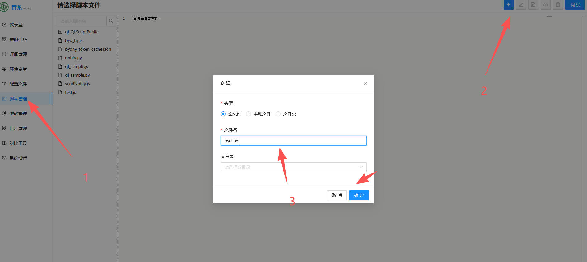
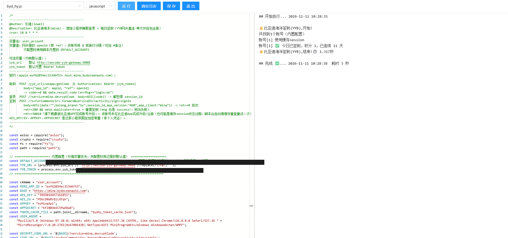

# 比亚迪海洋(mina)小程序 · 每日签到

基于青龙面板的比亚迪海洋小程序自动签到脚本：通过自部署的 YYB-Go-Enhanced 取码网关获取微信 `wx.login` code，完成静默登录并每日签到。

- **作者**：乐维(lewei)
- **脚本**：[`index.js`](index.js)（单文件自包含，无需任何仓库依赖）
- **定时**：`10 0 * * *`（每天 00:10，可自行调整）

## 工作原理

```
┌──────────────┐   POST /wxapp/getCode {app_id, ref}   ┌────────────────────┐   wx.login   ┌────────┐
│ 青龙: index.js │ ───────────────────────────────────▶ │ YYB-Go-Enhanced     │ ──────────▶ │  微信  │
│  (签到脚本)    │ ◀───────────── code ───────────────── │ 取码网关(后台保活)   │             └────────┘
└──────┬───────┘                                        └────────────────────┘
       │  AES-128-CBC 加密请求（code → session_id → 签到）
       ▼
  mina.bydoceanauto.com（比亚迪海洋小程序后端）
```

脚本本身不接触微信，取码完全交给网关；网关用原生协议保持微信登录态并**在后台自动续期凭据**（每 2 分钟检查，token 临期自动刷新），脚本每次需要时向它取一个新鲜 code。

> ⚠️ **账号安全提示**：协议登录属于非官方客户端行为，存在被微信风控的可能性（低概率但不为零）。**强烈建议用微信小号挂签到，不要用主力号**。手机端正常使用不受影响。

---

## 前置准备：部署青龙面板（Docker）

已有青龙可跳过。推荐 Docker 部署，一条命令：

```bash
docker run -dit \
  --name qinglong \
  --hostname qinglong \
  --restart unless-stopped \
  -p 5600:5700 \
  -v $PWD/ql/data:/ql/data \
  -e TZ=Asia/Shanghai \
  whyour/qinglong:latest
```

参数说明：

| 参数 | 说明 |
|---|---|
| `-p 5600:5700` | 面板端口映射到宿主机 5600（可改成你想要的端口） |
| `-v $PWD/ql/data:/ql/data` | 数据目录挂载，**重建容器不丢任务/配置/日志**，勿删 |
| `--restart unless-stopped` | 开机自启 |

初始化：

1. 浏览器打开 `http://<服务器IP>:5600`，按引导创建管理员账号密码；
2. 进入面板 → **依赖管理** → NodeJs → 新建依赖 `axios`（脚本唯一的第三方依赖，装一次即可）；
3. （可选）**配置文件** 里设置通知渠道（Server酱/Telegram/企业微信等），签到结果就能推送到手机。

> 公网服务器请在安全组/防火墙放行 5600 端口（仅自己 IP 可访问更安全）；`ql repo`、`task` 等命令的使用与下文一致。

---

## 第一步：部署 YYB-Go-Enhanced 取码网关（Docker）

项目地址：[525815266/YYB-Go-Enhanced](https://github.com/525815266/YYB-Go-Enhanced)。

需要一台能长期开机的机器：VPS、NAS、软路由、闲置电脑均可（和青龙同机最省事）。

### 部署步骤（docker compose，官方方式）

```bash
git clone https://github.com/525815266/YYB-Go-Enhanced.git
cd YYB-Go-Enhanced

# 建一个和青龙共用的 docker 网络（已有自建网络可跳过，记下网络名）
docker network inspect qinglong_default >/dev/null 2>&1 || \
  docker network create qinglong_default

cp .env.example .env
docker compose pull yyb-go

# 初始化数据目录权限（容器以非 root 用户运行，此步必做，否则 SQLite 报 unable to open database file）
mkdir -p data/db data/avatars data/qr
docker run --rm --user 0 --entrypoint sh \
  -v "$PWD/data:/data" ghcr.io/525815266/yyb-go-enhanced:latest \
  -c 'chown -R yyb:yyb /data/db /data/avatars /data/qr && chmod -R u+rwX /data/db /data/avatars /data/qr'

docker compose up -d --no-build
```

编辑 `.env`，关键项：

```ini
# 取码接口令牌，脚本侧要配的 yyb_token；公网或跨主机使用必须设置
YYB_PROTOCOL_TOKEN=换成你自己的随机长字符串

# 和青龙共用的 docker 网络名（不是容器名！用 docker network ls 或
# docker inspect qinglong --format '{{json .NetworkSettings.Networks}}' 查实际名字）
YYB_DOCKER_NETWORK=qinglong_default

# 宿主机映射绑定：127.0.0.1 仅本机/SSH 隧道访问（推荐）；0.0.0.0 暴露到局域网/公网
YYB_BIND_ADDRESS=127.0.0.1
# 宿主机映射端口
YYB_PORT=8000
```

> 注意：配置只在启动时读取，改 `.env` 后要 `docker compose up -d` 重建容器。
> 青龙若只有默认 bridge 网络，可热接入：`docker network connect qinglong_default qinglong`（最后一项换成实际容器名）。

### 扫码挂入微信号

浏览器打开 `http://<网关地址>:8000`（控制台首页），**第一个注册的账号自动成为管理员**。登录后在账号工作台用手机微信扫码 → 确认登录。登录态保存在 `./data` 目录，重启容器不丢。

网关会在后台自动保活续期，正常情况下无需再管；如果微信明确拒绝了 refresh token（被顶号、风控等），控制台会显示需要重扫，重新扫码即可。

> 公网部署时**不要把端口直接暴露到 0.0.0.0**（虽然接口有令牌鉴权）。需要远程访问控制台时用 SSH 隧道：`ssh -N -L 8000:127.0.0.1:8000 user@服务器`，然后访问 `http://127.0.0.1:8000`。

---

## 第二步：青龙面板启用脚本

### 2.1 放入脚本

青龙面板 → **脚本管理** → 右上角 **+** → 新建空文件（如 `byd_hy.js`）→ 把本仓库 [`index.js`](index.js) 的全部内容粘贴进去保存：



（也可以直接把 `index.js` 文件上传到 `/ql/data/scripts/` 目录。脚本是单文件自包含的，放任何位置都能跑。）

### 2.2 配置环境变量

面板 → **环境变量** → 新建：

| 变量名 | 必填 | 说明 | 示例 |
|---|---|---|---|
| `user_account` | ✅ | 网关里的 openid（即取码用的 ref，也支持账号数字 ID），多账号 `&` 分隔，支持 `#备注` | `oXXXX6vJevL3FFk6cueq1WtYXXXX#我的号` |
| `yyb_url` | ✅ | 网关地址（见下方"网络连通"） | `http://yyb-go:8000` |
| `yyb_token` | ✅ | 网关 `.env` 里的 `YYB_PROTOCOL_TOKEN` | 部署时设置的令牌 |

> openid 从哪来：网关控制台「账号工作台」里添加微信账号后可见；或直接调一次接口看返回里的 `data.openid`：
> ```bash
> curl -X POST http://<网关>:8000/wxapp/getCode \
>   -H "Authorization: Bearer <令牌>" \
>   -H "Content-Type: application/json" \
>   -d '{"app_id":"wxf62054ec313d6f53","ref":"<控制台里的账号ID或openid>"}'
> ```

### 2.3 网络连通（青龙和网关的相对位置）

| 部署形态 | `yyb_url` 怎么填 |
|---|---|
| 同机，两容器在同一自建 docker 网络（官方部署方式） | `http://yyb-go:8000`（容器名，**推荐**） |
| 同机，网关绑 `172.17.0.1`（docker0） | `http://172.17.0.1:8000` |
| 网关绑 `127.0.0.1` 且与青龙不在同一网络 | 容器内 `127.0.0.1` 指向容器自己，**不通**，改用上面两种方式之一 |
| 网关/青龙不同机 | `http://<网关机器IP>:8000`（网关需绑 `0.0.0.0` 或对应网卡地址） |

验证连通性（在宿主机执行）：

```bash
docker exec qinglong wget -qO- http://yyb-go:8000/health
# 有正常返回即通
```

### 2.4 建定时任务

面板 → **定时任务** → 新建：

- 命令：`task byd_hy.js`（脚本文件名）
- 定时：`10 0 * * *`

保存后手动点一次"运行"验证，日志出现 `✅ 签到成功`（或当日已签过的 `✅ 今日已签到`）即完成。



---

## 第三步（可选）：从零自建全套 Docker

如果青龙也还没装，一个 compose 全搞定（网关部分基于 YYB-Go-Enhanced 官方 compose 精简）：

```yaml
name: sign-stack
services:
  qinglong:
    image: whyour/qinglong:latest
    container_name: qinglong
    restart: unless-stopped
    ports:
      - "5600:5700"
    volumes:
      - ./ql/data:/ql/data
    environment:
      TZ: Asia/Shanghai

  yyb-go:
    image: ghcr.io/525815266/yyb-go-enhanced:latest
    container_name: yyb-go
    restart: unless-stopped
    command: ["-host", "0.0.0.0", "-port", "8000", "-resource-root", "/app/resource"]
    environment:
      TZ: Asia/Shanghai
      YYB_PROTOCOL_TOKEN: ${YYB_PROTOCOL_TOKEN}
    volumes:
      - ./yyb/data/db:/app/resource/db
      - ./yyb/data/avatars:/app/resource/avatars
      - ./yyb/data/qr:/app/resource/qr
    # 不映射端口：与青龙同网络，容器名直达，外部摸不到
```

```bash
echo 'YYB_PROTOCOL_TOKEN=换成随机长字符串' > .env

# 初始化数据目录权限（容器以非 root 用户运行，必做）
mkdir -p yyb/data/db yyb/data/avatars yyb/data/qr
docker run --rm --user 0 --entrypoint sh \
  -v "$PWD/yyb/data:/data" ghcr.io/525815266/yyb-go-enhanced:latest \
  -c 'chown -R yyb:yyb /data/db /data/avatars /data/qr && chmod -R u+rwX /data/db /data/avatars /data/qr'

docker compose up -d
```

此时 `yyb_url=http://yyb-go:8000`（同一 compose 网络内容器名互通）。青龙面板在 `http://<机器IP>:5600`。网关控制台不映射端口时无法从浏览器访问，可临时加端口映射 `127.0.0.1:8000:8000` 配合 SSH 隧道扫码，扫完再去掉。

如果已经有网关、只缺青龙，单起青龙用官方命令：

```bash
docker run -dit \
  --name qinglong \
  --hostname qinglong \
  --restart unless-stopped \
  -p 5600:5700 \
  -v $PWD/ql/data:/ql/data \
  -e TZ=Asia/Shanghai \
  whyour/qinglong:latest
```

（`-p 5600:5700` 把面板映射到 5600 端口；`-v` 挂载数据目录，重建容器不丢任务和配置。）

---

## 常见问题

**Q：日志报 `Cannot find module 'axios'`**
A：青龙依赖没装。面板 → 依赖管理 → NodeJs → 新建 `axios`，装完重跑。

**Q：`签到失败(ret=50010): 请下载最新"比亚迪"APP完成账号升级`**
A：两种可能：① 缓存 session 是账号升级前建的——脚本已内置处理，遇到 50010 会自动清缓存重新登录重试一次；② 重试后仍报，说明该微信号确实没完成比亚迪 App 账号升级：用该微信登录比亚迪 App / 海洋小程序，完成手机号绑定后再跑。

**Q：日志显示 `✅ 今日已签到，积分 1，已连续 N 天` 但没跑签到？**
A：今天已经签过了（服务端重复签到返回 `ret=200`，msg 也是 `success!`），脚本会识别为成功，不是错误。

**Q：`getaddrinfo ENOTFOUND yyb-go` / 连接超时**
A：网络没通，回 2.3 节对照部署形态选地址；用 `docker exec qinglong wget -qO- <yyb_url>/health` 验证。注意：容器名解析要求两容器在同一**自建** docker 网络（默认 bridge 网络不支持容器名 DNS），且青龙容器没有配自定义 DNS。

**Q：扫码后过几天签到开始失败？**
A：YYB-Go-Enhanced 有后台自动保活，一般不会掉。如果掉了（微信拒绝 refresh token，如被顶号、风控），网关控制台会显示账号需要重扫，打开控制台重新扫码即可，同时删掉青龙里的 `bydhy_token_cache.json` 让脚本重新登录。

**Q：网关日志报 `unable to open database file: out of memory (14)`**
A：数据目录权限问题（报错文本有误导性，实际是 SQLite 打不开文件）。容器以非 root 的 `yyb` 用户运行，按部署步骤里的 `chown` 命令初始化 `data` 目录权限后重启即可。

**Q：`bydhy_token_cache.json` 是什么？**
A：脚本在自身目录缓存的 session_id，避免每次都消耗 code 登录。缓存按天自动刷新（只复用当天获取的 session），session 失效会自动重登，文件可放心删除。

## 免责声明

本项目仅供学习交流使用，请勿用于商业或非法用途。使用第三方协议网关登录微信存在账号风控风险，请自行评估并建议使用小号。因使用本项目产生的任何后果由使用者自行承担。
